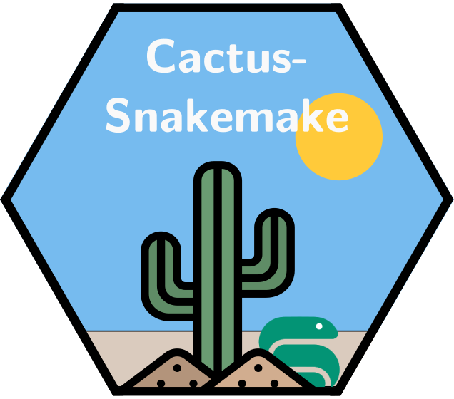

<div align="center">
  
</div>

<div align="center">
  <a href="https://doi.org/10.5281/zenodo.20614344"></a>
  
</div>

### These pipelines facilitate the running of the [Cactus whole genome alignment tool](https://github.com/ComparativeGenomicsToolkit/cactus) efficiently on SLURM (and possibly other) clusters.

## Tutorials available on the [FAS Informatics website](https://informatics.fas.harvard.edu/):

### <[Whole genome alignment with Progressive Cactus](https://informatics.fas.harvard.edu/resources/tutorials/whole-genome-alignment-cactus/)>

#### <[Adding a genome to a whole genome alignment](https://informatics.fas.harvard.edu/resources/tutorials/add-to-whole-genome-alignment-cactus/)>

#### <[Adding an outgroup to a whole genome alignment](https://informatics.fas.harvard.edu/resources/tutorials/add-outgroup-to-whole-genome-alignment-cactus/)>

#### <[Replacing a genome in a whole genome alignment](https://informatics.fas.harvard.edu/resources/tutorials/replace-genome-whole-genome-alignment-cactus/)>

### <[Pangenome inference with Minigraph-Cactus](https://informatics.fas.harvard.edu/resources/tutorials/pangenome-cactus-minigraph/)>

> ⚠️ **Important!** cactus-snakemake v3.0.0 and later requires Cactus v3.0.0 or later. 
>
> Due to bug fixes in Cactus, v3.0.0+ of cactus-snakemake is only compatibile with Cactus v3.0.0 or later. Don't worry, cactus-snakemake will always use the latest version of Cactus available unless you specify otherwise in your config file. However, if you do wish to use an older version of Cactus, you can use [cactus-snakemake v2.1.0](https://github.com/harvardinformatics/cactus-snakemake/releases/tag/v2.1.0).

## Installation

Clone the repository, then use the `cactus_snakemake` wrapper to create its conda environment:

```{bash}
git clone https://github.com/harvardinformatics/cactus-snakemake.git
cd cactus-snakemake
./cactus_snakemake setup    # create the conda environment from envs/environment.yml
./cactus_snakemake check    # confirm the environment and singularity are ready (read-only)
```

Alternatively, you could just manually download the [latest release](https://github.com/harvardinformatics/cactus-snakemake/releases/latest) and unzip it, then run the same `setup` command.

Requirements:

- `conda` or `mamba`, for `setup`. The environment is named `cactus-snakemake`; use `--env-name NAME` before the command (or `CACTUS_SMK_ENV_NAME`) for a different one.
- Singularity, which conda can't provide: the pipelines run Cactus with `singularity exec`. Apptainer installs usually provide a `singularity` command.
- For most datasets, a cluster with the SLURM job scheduler.

Run `./cactus_snakemake help` for every command and option.

## Usage

There are five pipelines, each with its own Snakefile and [config template](config-templates/):

| Pipeline | What it does | Snakefile | Config template |
| -------- | ------------ | --------- | --------------- |
| `align` | Progressive Cactus whole genome alignment | `cactus.smk` | `config-template.yaml` |
| `add-genome` | Add a genome to an existing alignment by splitting a branch | `cactus_add_genome.smk` | `add-genome-config-template.yaml` |
| `replace-genome` | Replace a genome in an existing alignment | `cactus_replace_genome.smk` | `replace-genome-config-template.yaml` |
| `add-outgroup` | Add a genome as a new outgroup above the root of an existing alignment | `cactus_add_outgroup.smk` | `add-outgroup-config-template.yaml` |
| `minigraph` | Minigraph-Cactus pangenome | `cactus_minigraph.smk` | `minigraph-config-template.yaml` |

Running a pipeline takes three steps, shown here for `align`:

```{bash}
# 1. Write a starter config from the pipeline's template, then fill in the blank fields
./cactus_snakemake init align -o my-config.yaml

# 2. Prep, once per output directory
./cactus_snakemake prep align --configfile my-config.yaml

# 3. Dry-run to check the job plan, then run for real
./cactus_snakemake run align --configfile my-config.yaml -j 20 -e slurm --dryrun
./cactus_snakemake run align --configfile my-config.yaml -j 20 -e slurm
```

`run` passes everything after the pipeline name to Snakemake. Give `-j` (the number of jobs to submit at once) whenever you use `-e slurm`: recent Snakemake versions require it even for a dry-run.

### Prep

Prep resolves the Cactus image (downloading it if `cactus_path` is `download` or a version tag), runs `cactus-prepare` (`cactus-update-prepare` for `add-genome` and `replace-genome`), and records what it did in `<output_dir>/prep-manifest.yaml`. `add-outgroup` and `minigraph` have no prepare command, so for them prep only resolves the image.

Every run, including each cluster job, reads that manifest instead of repeating prep, and stops with an error if:

- prep hasn't been run for the output directory yet. The error gives the command to run.
- the config or input files that prep depended on have changed since (for example the tree in `input_file`, `cactus_path`, or where a new genome goes), or a file prep wrote has been changed. The error lists what changed.

If a change is intended, prep again with `--force`. Files already in the output directory were made from the earlier prep and are not deleted, so for anything that changes the tree, a new output directory is usually the safer choice.

### GPU

For GPU-enabled blast rules, configure exactly one of `gpus` or `gres` in the relevant `rule_resources.blast` block. Use `gpus` to request Snakemake's `gpu` resource, or use `gres` with any of `1`, `a100:2`, `gpu:1`, or `gpu:a100:2`. If the `gpu:` prefix is omitted, the pipeline adds it before submitting the Slurm GRES request.

> 💡 **Tip:** Automatic partition selection
>
> The SLURM executor plugin can choose a partition for each job from its resource requests, given a partition config for your cluster. Add `--slurm-partition-config <path to your cluster's partition config>` to your `run` (or `snakemake`) commands, and the partitions in your pipeline config can be left blank. See the [SLURM executor plugin documentation](https://snakemake.github.io/snakemake-plugin-catalog/plugins/executor/slurm.html) for the config format.

### Without the wrapper

The wrapper only runs Snakemake for you; the same steps work with Snakemake directly, from an environment that has the packages in `envs/environment.yml`:

```{bash}
snakemake -s cactus.smk --configfile my-config.yaml --config prep=T
snakemake -s cactus.smk --configfile my-config.yaml -j 20 -e slurm --dryrun
snakemake -s cactus.smk --configfile my-config.yaml -j 20 -e slurm
```

For more information, see the setup and run instructions in each of the tutorials linked above.

## Meta config options

Several meta config options exist across pipelines as pseudo-command line flags, for running Snakemake directly. `cactus_snakemake prep` passes `prep=T` (and `prep_force=T` with `--force`) for you.

| Command line flag    | Description |
| -------------------- | ----------- |
| `--config prep=T`    | Run the prep step and exit (see [Prep](#prep)). Required once per output directory before the pipeline can run. |
| `--config prep=T prep_force=T` | Run prep again even though the config or input files have changed since the last prep. |
| `--config debug=T`   | The same as prep, but display extra information about the pre-processing steps. |
| `--config display=T` | Print the current config settings and exit |
| `--config info=T`    | Display some information about the pipelines, including version and last commit date |
| `--config version=T` | Display the version of the pipeline |

## Upgrading from v3

- **Prep is a separate, required step.** v3 ran `cactus-prepare` (or `cactus-update-prepare`) every time Snakemake was invoked. Now it runs only during prep, and every other run stops until prep has been done for its output directory. For an output directory from v3, run prep once with the same config and input files, then run the pipeline as before. For `add-genome` and `replace-genome`, prep rewrites `seq_file.in`/`seq_file.out` one last time, so the next run redoes their steps from `preprocess` once, as every v3 resume did. If an `add-genome` or `replace-genome` run with `overwrite_original_hal: True` has already started modifying the input HAL, don't prep it again; start over from a copy of the original HAL.
- **Renamed files:** `cactus_update.smk` is now `cactus_add_genome.smk` and `cactus_replace.smk` is now `cactus_replace_genome.smk`, with their config templates renamed to match. Config keys are unchanged.
- **`skip_prepare` is no longer used.** It existed to stop `cactus-update-prepare` re-running on every invocation, which no longer happens. If it's set, the pipelines log a warning and otherwise ignore it.
- **KegAlign patch support was removed.** It only applied to GPU runs of Cactus v2.9.9, which cactus-snakemake has not supported since v3.0.0.

## Citation

If you use this software, please cite:

##### Latest version

Thomas, G. (2026). Snakemake workflows for Cactus (Version 3.5.0) [Computer software]. 
[https://doi.org/10.5281/zenodo.20614344](https://doi.org/10.5281/zenodo.20614344)

> **To cite a specific version:**  
> See the [full list of versions and DOIs here](https://zenodo.org/records/15596990).  
> (Find the version you used in the Zenodo version history.)
